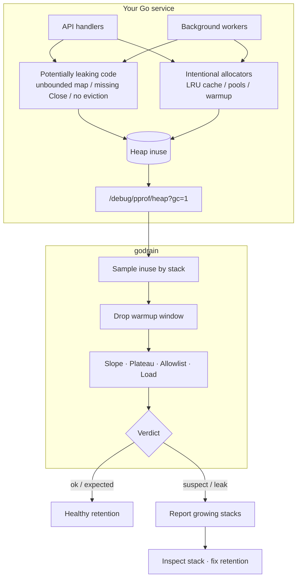

<p align="center">
  
  
</p>

<p align="center">
  <b>Runtime detection of uncontrolled heap retention in Go.</b>
</p>

<p align="center">
  Growing memory is not always a leak — caches and pools allocate on purpose.<br/>
  godrain finds retained heap that keeps climbing after GC, and shows which stacks hold it.
</p>

<p align="center">
  <a href="https://github.com/gonnafaraway/godrain/actions/workflows/ci.yml"></a>
  <a href="https://pkg.go.dev/github.com/gonnafaraway/godrain/cmd/godrain"></a>
  <a href="https://github.com/gonnafaraway/godrain/releases/tag/v0.1.0"></a>
  <a href="./LICENSE"></a>
</p>

<p align="center">
  <a href="#install">Install</a>
  &nbsp;|&nbsp;
  <a href="#quickstart">Quickstart</a>
  &nbsp;|&nbsp;
  <a href="#how-it-works">How it works</a>
  &nbsp;|&nbsp;
  <a href="#cli">CLI</a>
  &nbsp;|&nbsp;
  <a href="#roadmap">Roadmap</a>
</p>

```bash
go install github.com/gonnafaraway/godrain/cmd/godrain@latest
```

## Quickstart

Expose pprof in your service (**private bind only**):

```go
import (
	"log"
	"net/http"
	_ "net/http/pprof"
)

go func() {
	log.Println(http.ListenAndServe("127.0.0.1:6060", nil))
}()
```

Watch under steady load:

```bash
godrain watch \
  --url http://127.0.0.1:6060 \
  --warmup 1m \
  --duration 5m \
  --interval 15s
```

Or launch the binary for you:

```bash
godrain run --url http://127.0.0.1:6060 --warmup 1m --duration 5m -- ./your-service
```

## How it works



godrain samples `inuse_*` **after GC**, attributes growth to call stacks, then classifies:

| Signal | Intentional | Uncontrolled |
|--------|-------------|--------------|
| Shape | rises, then **plateau** | sustained **slope** |
| Allowlist | known cache / pool stacks | not listed |
| Load (optional) | tracks RPS / queue depth | load flat, heap still climbs |

| Verdict | Meaning |
|---------|---------|
| `ok` | no meaningful growth, or plateau |
| `expected` | allowlisted, or correlates with load |
| `suspect` | sustained retained growth without plateau |
| `leak` | long window + high slope + no allowlist / no load correlation |

## Check a real service

1. **Steady-state load** — warm caches, hold roughly constant RPS / queue depth.
2. **Baseline watch** with `--warmup 1m --duration 5m --interval 15s`.
3. **Split surfaces** when unclear: API-only → workers-only → together.
4. **Attach load** with `--load-url` / `--load-metric` when possible.
5. **Allowlist** intentional allocators — see [configs/allowlist.example.yaml](configs/allowlist.example.yaml).
6. **Read the top stack** — that is where retention is attributed.

## Output

Progress → **stderr**. Report → **stdout**.

```text
godrain verdict: suspect
reason: sustained retained growth without plateau (main.main.func1)
samples: 6  window: 25s  total_growth: 34.6 MiB  total_slope: 1.4 MiB/s

Top growing stacks:

#1 [suspect] growth=34.6 MiB slope=1.4 MiB/s plateau=false allowlisted=false
  reason: sustained retained growth without plateau
  main.main.func1
    .../path/file.go:22
```

Use `--json` for CI. Exit codes: `0` ok/expected · `1` suspect/leak/error · `2` usage.

## CLI

```text
godrain watch --url URL [flags]
godrain run   --url URL [flags] -- <command> [args...]
godrain diff  <before.pb.gz> <after.pb.gz>
godrain version
```

| Flag | Description | Default |
|------|-------------|---------|
| `--url` | pprof base URL | required for `watch` |
| `--duration` | observation window | `2m` |
| `--interval` | sample period | `10s` |
| `--warmup` | ignore leading growth | `15s` |
| `--allowlist` | YAML patterns file | — |
| `--save-dir` | persist raw profiles | — |
| `--load-url` | load metric URL | — |
| `--load-metric` | Prometheus metric name | — |
| `--json` | JSON report | off |
| `--min-growth` | min stack growth (bytes) | `65536` |
| `--suspect-slope` | suspect threshold (bytes/s) | `8192` |
| `--leak-slope` | leak threshold (bytes/s) | `65536` |
| `--plateau-epsilon` | plateau sensitivity | `0.08` |
| `--no-exit-code` | do not fail on suspect/leak | fail enabled |

## Limitations and false positives

godrain is a heuristic runtime detector, not a proof of a leak.

You may see **false `suspect`/`leak`** when:

- the observation window is shorter than cache fill / GC settling time
- load is ramping (deploy, traffic spike) and no `--load-url` is provided
- intentional unbounded-looking growth is not allowlisted yet
- the process is idle and noise dominates tiny slopes

You may see **false `ok`** when:

- the leak is slower than `--suspect-slope` / `--min-growth`
- the leak only happens on a rare code path not exercised during the watch
- warmup/duration are too short for the retention to appear

Practical guidance: use longer soaks for production confidence, attach a load metric, and iterate on allowlists after the first report.

## Compared to alternatives

| Tool | Best for | Not a replacement for |
|------|----------|------------------------|
| **godrain** | automated retained-heap growth classification under load | deep interactive profile forensics |
| `go tool pprof` | interactive exploration of one profile | CI-friendly leak/no-leak verdicts |
| continuous profilers (Pyroscope, etc.) | always-on historical flamegraphs | opinionated uncontrolled-retention verdicts |
| `goleak` | goroutine leaks in tests | heap retention in long-running services |

## Security

Treat `/debug/pprof` as sensitive. Bind to localhost / private networks only. See [SECURITY.md](SECURITY.md).

## Demo

```bash
go run ./testdata/leaky   # :6061 — unbounded map → suspect/leak
go run ./testdata/cached  # :6062 — bounded LRU → ok

godrain watch --url http://127.0.0.1:6061 --duration 45s --interval 5s --warmup 5s
godrain watch --url http://127.0.0.1:6062 --duration 45s --interval 5s --warmup 5s
```

## Install

```bash
go install github.com/gonnafaraway/godrain/cmd/godrain@latest

# or from this repo
make build
```

Binaries for Linux / macOS / Windows are published on the [Releases](https://github.com/gonnafaraway/godrain/releases) page.

## Develop

```bash
make check   # tidy + vet + test + lint
make build
```

See [CONTRIBUTING.md](CONTRIBUTING.md).

## Roadmap

See [ROADMAP.md](ROADMAP.md) for near-term and later work (goroutine mode, HTML reports, Kubernetes recipes, and more).

## Out of scope

- static source analysis
- automatic code fixes
- replacing interactive `go tool pprof` for deep single-profile forensics

godrain answers one question well: **is retained heap growing without control under your load, and which stacks are responsible?**

## License

[MIT](./LICENSE) © w0i
